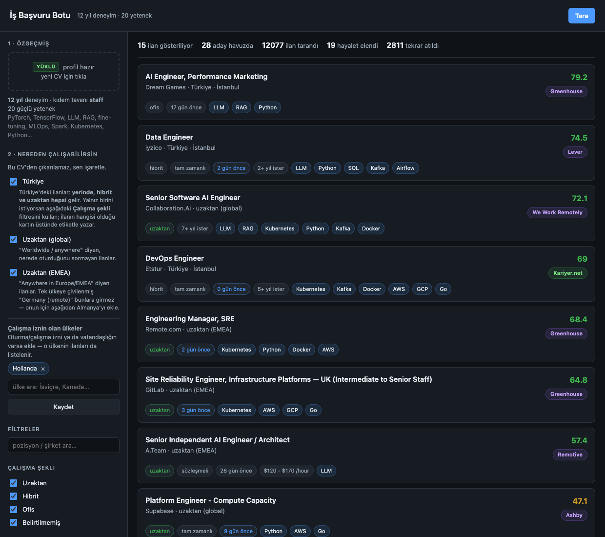

# is-basvuru-bot

CV'nizi alır, şirketlerin **herkese açık ilan API'lerinden** iş ilanı toplar, CV'nize
göre puanlar, **hayalet ilanları** ayıklar ve gerekçeli bir kısa liste çıkarır.

Kişiye özel değildir: motor tamamen `config/profile.yaml` güdümlüdür, kendi CV'nizle
çalışır. Profil dosyasını CV'nizden otomatik üretebilirsiniz. Yazılım dışı meslekler
de kapsanır — sağlık, hukuk, inşaat, muhasebe, lojistik, gıda, enerji, eğitim,
turizm, satış, tekstil, kimya, madencilik, denizcilik ve savunma sanayii dâhil.

İki arama kipi vardır:

- **Hızlı arama** — sözlük ve kural motoru. Yetenek, rol ailesi, kıdem ve konum
  eşleşmesine bakar. Açıklanabilir: her puanın gerekçesi yazılır.
- **Gelişmiş arama** — buna ek olarak **yerel bir model**, ilanın gerçekten sizin
  işiniz olup olmadığını anlam düzeyinde denetler. İnternet gerekmez, CV ve ilan
  metni makineden çıkmaz.

```bash
git clone https://github.com/berketez/is-basvuru-botu.git
cd is-basvuru-botu
./calistir.sh            # Windows: bkz. "Kurulum" başlığı
```

`calistir.sh` kendi izole ortamını kurar (sistem Python'ına dokunmaz), eksik
paketleri yükler ve paneli açar. Başka bir şey kurmana gerek yok.

## Neden bot koruması atlatılmıyor

Bu araç LinkedIn'e **hiç** girmez; kariyer.net ve eleman.net'i yalnız herkese açık
kategori sayfalarından, **az ve yavaş** okur (bkz. "Türk panoları"). Bot korumalarını
atlatmaya çalışmaz: parmak izi taklidi, CAPTCHA çözme, IP/proxy değiştirme, "fark
edilmeyen" tarayıcılar **yoktur**. Sebebi pratik: koruma engeli kullanıcının kendi IP'sine
düşer — iş arayan biri aynı siteye aynı ağdan başvuru da yapar — ve oturum açmış bir
hesapla otomasyon hesabın askıya alınmasıyla sonuçlanır. İş arayan için kaybedilecek en
pahalı şeyler bunlardır.

Onun yerine **ön kapıdan** girer:

- **İlanlar çoğunlukla platformlara ait değildir.** Şirket Greenhouse/Lever/Ashby/Workable
  kullanıyorsa, ilan o sistemin **kimlik doğrulaması istemeyen, herkese açık JSON ucunda**
  durur. Atlatılacak koruma yoktur; o uçlar okunmak için vardır. Üstelik scraping'den
  iyidir: yapılandırılmış veri, HTML değişince kırılmaz.
- **Platforma özel ilanlar için** platformun kendi **iş alarmı e-postaları** kullanılır
  (kullanıcı alarmı kurar, platform ilanı kendisi gönderir, araç kullanıcının kendi gelen
  kutusunu okur). *Henüz yazılmadı — yol haritasında.*
- **Başvurunun kendisi** API ile mümkün değildir; Greenhouse'un başvuru ucu işverenin
  anahtarını ister. Dolayısıyla başvuru, formu doldurup **son "gönder" tıklamasını
  kullanıcıya bırakarak** yapılır. *Henüz yazılmadı — yol haritasında.*

## Kurulum

Gereken tek şey **Python 3.10+**. Üç yol var; sırayla dene.

### 1) Önerilen — `./calistir.sh`

```bash
./calistir.sh
```

Ne yapar: Python sürümünü denetler → `.venv/` içinde izole ortam kurar →
eksik paketleri yükler → paneli açar. Sistem Python'ına **hiçbir şey yazmaz**.
İkinci çalıştırmada kurulum adımlarını atlar, doğrudan açılır.

Windows'ta (PowerShell):

```powershell
python -m venv .venv
.venv\Scripts\pip install -r requirements.txt
.venv\Scripts\python -m isbot panel
```

### 2) Elle — kendi ortamını yönetiyorsan

```bash
pip install -r requirements.txt
python -m isbot panel
```

### 3) Çift tıklanan uygulama (.app) — macOS

Terminal görmek istemiyorsan:

```bash
pip install -r requirements-paket.txt      # pyinstaller dahil
./kur.sh
```

Uygulama `~/Applications/IsBasvuruBotu.app` altına kurulur, derleme çıktısı silinir,
sistemde tek kopya kalır. Çift tıkla: yerel sunucu açılır, tarayıcı kendiliğinden gelir.

- Veriler `~/is-basvuru-bot/` altında tutulur (profil, veritabanı, çıktılar).
- Sunucu **yalnızca 127.0.0.1**'e bağlanır; ağdaki başka makineler erişemez.
- CV makineden hiç çıkmaz.
- **Kapatmak:** Dock simgesine sağ tık → Çık. Sunucu da kapanır.
- Zaten açıkken simgeye tıklamak ikinci sunucu başlatmaz, panel sekmesini geri açar.
- **Bir şey ters giderse:** Finder'dan açılan uygulamanın terminal çıktısı yoktur;
  her şey `~/Library/Logs/IsBasvuruBotu.log` dosyasına yazılır. Önce oraya bak.

macOS notu: paket ad-hoc imzalanır. Başka bir makineye kopyalarsan Gatekeeper uyarır;
kullanıcı sağ tık → Aç demeli. Sorunsuz dağıtım için Apple geliştirici sertifikası +
notarization gerekir (yıllık ücretli).

### Sistem bağımlılığı: `pdftotext` (önerilir)

PDF'ten metin çıkarmanın **asıl** yolu poppler'ın `pdftotext` aracıdır; sütunlu
CV'lerde pypdf'ten belirgin biçimde daha iyi sonuç verir. Yoksa araç `pypdf`'e düşer
ve çalışmaya devam eder — ama iki kolonlu bir CV'de metin karışabilir.

```bash
brew install poppler                 # macOS
sudo apt install poppler-utils       # Debian / Ubuntu
```

Windows: <https://github.com/oschwartz10612/poppler-windows> (indir, `bin/` klasörünü PATH'e ekle)

## Kullanım (komut satırı)

```bash
# 1) CV'nizden profil taslağı üretin (PDF / TeX / DOCX / MD / TXT)
python -m isbot cv-import ~/cv.pdf -o config/profile.local.yaml

# 2) Taslağı gözden geçirin — özellikle: calisma_izni, zorunlu_konum_kosulu, max_kidem
#    (bunlar CV'den güvenilir biçimde çıkarılamaz)

# 3) Tarayın
python -m isbot tara --min-puan 25 -n 25

#    Uyum hakemiyle (yerel model; ilanın gerçekten sizin işiniz olup olmadığını denetler)
python -m isbot tara --gelismis -n 25

# Yardımcılar
python -m isbot dogrula greenhouse anthropic   # bir ATS anahtarını sına
python -m isbot durum                          # veritabanı istatistikleri
python -m isbot panel                          # web panelini aç
```

Çıktı: terminalde tablo + `out/ilanlar-<tarih>.md` içinde her ilan için gerekçe
(hangi yetenekler eşleşti, neyi tutturamıyorsunuz, konum neden uygun, ilan kaç günlük).

## Gelişmiş arama (uyum hakemi)

Motor sözcüğe bakar, anlama bakmaz. İki tipik kırılma ölçüldü:

- Türkçede **"kontrol"** hem *control systems* hem *quality control* demek.
  kariyer.net'te "kontrol mühendisi" sorgusunun 51 sonucunun **tamamı** kalite
  kontrol / kontrol odası ilanıydı.
- CV'sinde "AutoCAD sertifikalı" yazan bir kontrol mühendisi adayına
  **"CAD/CAM Operatör Yardımcısı"** ilanı 50,2 puanla kısa listenin ikinci
  sırasından geldi. Başlık kalıbı tutuyor, yetenek tutuyor — ama iş adaya ait değil.

Gelişmiş arama bu kararı anlam düzeyinde verir: adayın **ne olduğunu** ve **ne
olmadığını** anlatan iki cümle kurulur, ilan ikisine de kıyaslanır, fark alınır.
Yalnız "uygun mu" diye sormak yetmiyordu; "kalite kontrol mühendisi" ilanı da
adaya benziyor. Ayrımı yaratan, adayın işi *olmayan* mesleklere olan yakınlığın
düşülmesi.

**Model elemez.** Kendisi de yanılıyor (ölçümde bir pazarlama ilanına olumlu skor
verdi). Bu yüzden yalnız puanı dar bir bantta (±%18) düzeltir ve şüpheli bulduğunu
`uyum şüpheli` etiketiyle işaretler. Eleme kararı motorun sert filtrelerinde kalır.

Ölçülen (14 Eyl 2026):

| | Yalnız motor | Gelişmiş arama |
|---|---|---|
| 10.834 ilan, 12 CV, alan isabeti | 52/60 | **54/60** |
| Kötüleşen CV | — | **0** |

Türkçe karışık havuzlarda fayda daha yüksek: savunma sanayii havuzunda CAD/CAM
operatör ilanları negatife düştü, mühendislik ilanları pozitif kaldı.

**Teknik:** çok dilli cümle gömme modeli (118M parametre), ONNX int8 — ~113 MB
model + 16 MB sözlükleyici. PyTorch **gerekmez**. Model `.app` içine gömülür;
kaynaktan çalıştırırken `./calistir.sh --model-indir` ile bir kez indirilir.
Yoksa panelde gelişmiş seçeneği hiç görünmez, motor eskisi gibi çalışır.

**Zayıf donanım:** en çok 400 ilan denetlenir ve denetim 90 saniyeyi aşarsa kalanı
bırakılır. Denetlenmeyen ilan **kaybolmaz** — motorun kendi puanıyla listede kalır.
Model dosyası donanıma özel değildir (genel int8; AVX512'ye bağlı sürüm bilerek
kullanılmadı).

## Hayalet ilan tespiti

Hayalet/havuz ilanı ("talent pool", yıllardır açık duran kadro) tespiti iki grup
sinyale dayanır. İlk koşuda yalnızca birinci grup çalışır; araç düzenli koştukça
veritabanı büyür ve tespit keskinleşir.

**Anında:** ilan yaşı (>1 yıl, >2 yıl, >3 yıl kademeleri) · "talent pool / expression of
interest / genel başvuru" kalıpları · "ileride açılacak pozisyonlar için" ifadeleri ·
konum enflasyonu · yayın tarihinin hiç verilmemesi

**Zamanla (≥2 koşu):** *sahte tazeleme* — güncelleme tarihi ilerlemiş ama ilan metni
harfi harfine aynı · *yeniden yayım* — aynı başlık kapanıp yeni kimlikle açılmış ·
hiç kapanmama

## Arayüz



İş sitelerinin standart filtreleri var: arama, **çalışma şekli** (uzaktan/hibrit/ofis),
**istihdam türü** (tam zamanlı/yarı zamanlı/sözleşmeli/staj), yayın tarihi, en az
uygunluk puanı, şirket ve **hayalet ilan** bandı. Bir karta tıklayınca gerekçe açılır:
hangi yetenekler eşleşti, neyi tutturamıyorsun, konum neden uygun, tazelik sinyalleri.

Çalışma şekli ve istihdam türü ATS'ler bunu tutarsız verdiği için türetilir
(Greenhouse hiç vermiyor). Çıkarılamıyorsa **"belirtilmemiş"** yazar — uydurulmaz.

**Nereden çalışabilirsin** adımı CV'den çıkarılamaz, elle işaretlenir: Türkiye, uzaktan
(global), uzaktan (EMEA) ve **çalışma izninin olduğu ülkeler**. Ülke listesi sabit
değildir; motorun tanıdığı ülkeler `/api/ulkeler` ucundan gelir ve arayüzde aranıp
eklenir (İsviçre, Kanada, Hollanda…). Ülke eklemek için tek yer düzenlenir:
`isbot/scoring.py` içindeki `ULKELER` kataloğu — arayüz kendiliğinden güncellenir.

Türkiye işaretliyken ülke içindeki ilanların **hepsi** gelir: yerinde, hibrit, uzaktan.
Hangisi olduğu kartın üstünde etiketle yazar; yalnız birini istiyorsan **çalışma şekli**
filtresi kullanılır. Konum satırı yalnız şehir içeriyorsa ("Zurich", "Berlin") ülke
şehirden çözülür; çözülemeyen kapsam **uygun sayılmaz** (fail-closed).

## Kaynaklar

**Şirket başına** (anahtar = ATS'teki şirket token'ı): Greenhouse, Lever, Ashby,
Workable, SmartRecruiters.

**Şirketler-arası** (anahtar = arama sorgusu ya da tüm akış): Remotive, RemoteOK,
**Arbeitnow** (Almanya/AB, tüm sektörler), **The Muse** (ABD, tüm sektörler, kıdem
bilgisini kendisi veriyor), **Himalayas** (son geçerlilik tarihi + maaş), **Jobicy**,
**We Work Remotely**.

**Türkiye** (HTML, robots.txt'ye uyumlu, iki aşamalı): **Kariyer.net**, **Eleman.net**. Bunlar önemli çünkü
Greenhouse/Lever/Ashby'nin şirketler-arası indeksi yoktur — her şirketi tek tek eklemek
gerekir. Toplayıcılar tek istekte yüzlerce şirketi tarar. Remotive'in
`candidate_required_location` alanı ("Worldwide", "USA Only") ilanın kendi beyanıdır;
konumu metinden çıkarmaktan çok daha güvenilir.

## Şirket listesi

`config/companies.yaml` — 74 şirket, anahtarların tamamı canlı doğrulanmış.

**Yeni şirket eklerken kimliği teyit edin.** Anahtar tahmini sahte eşleşme üretir:
doğrulama sırasında `greenhouse/peak` Teksas'ta bir fizik tedavi kliniği,
`greenhouse/insider` ABD'li bir haber sitesi çıktı. `python -m isbot dogrula <kaynak>
<anahtar>` komutu ilan konumlarını da basar; oradan teyit edin.

Anahtarı bulmak: şirketin kariyer sayfası URL'sinin son kısmı —
`job-boards.greenhouse.io/ANAHTAR`, `jobs.lever.co/ANAHTAR`,
`jobs.ashbyhq.com/ANAHTAR`, `apply.workable.com/ANAHTAR`.

### Türkiye kapsamı hakkında dürüst not

Türk şirketlerinin büyük kısmı kariyer.net veya kendi sistemleri üzerinden ilan verir ve
herkese açık API'leri yoktur. Yalnızca uluslararası ölçekte çalışanlar Lever/Greenhouse
kullanır (Trendyol, Dream Games, Peak Games, iyzico, Midas, Picus, Intenseye doğrulandı).

**Savunma sanayii ve havacılık** için ayrı bir kanal var. ASELSAN, TUSAŞ, ROKETSAN gibi
kurumların herkese açık ATS ucu yoktur ve bir kısmının kendi sitesi bot korumasının
arkasındadır — o kapılar zorlanmaz. Bunun yerine kariyer.net'in **sektör sayfaları**
kullanılır (`/is-ilanlari/savunma+sanayi`, `/is-ilanlari/havacilik`): bunlar sitenin
kendi sitemap'inde ilan ettiği, robots-izinli kanonik yollardır ve o sektördeki
şirketlerin ilanlarını tek sayfada verir. Rol ailesi "havacılık/savunma" veya
"kontrol/otomasyon" olarak tespit edilen profillerde bu sorgular otomatik eklenir.

Ölçüldü (14 Eyl 2026): bu iki sorgu 152 ilan getirdi; içinde ASELSAN, ASİSGUARD, TEDEG,
MENATEK, Lentatek ve Leonardo Turkey vardı. Sektör sayfası olduğu için karışık gelir
(operatör, idari, üretim ilanları da dâhil) — ayıklama puanlamaya bırakılır.

**Sınır:** bu kurumların ilanlarının tamamı kariyer.net'e düşmez; bir bölümü yalnız kendi
kariyer portallarında durur. Araç onları göremez ve göremediğini söyler.

#### Kapsam nasıl genişletiliyor

Ölçüldü (14 Eyl 2026): bir taramada 12.154 ilanın %82'si yabancı ATS'lerden geliyordu
(Greenhouse 5.694, Ashby 2.064) ama kariyer.net'ten yalnız **329** ilan alınıyordu —
oysa kısa listedeki 124 ilanın **122'si** o panodandı. En değerli kaynak en dar olanıydı.

Sebep: sorgu başına yalnız en iyi 2 kategori sayfası çekiliyordu ve kariyer.net kategori
sayfaları **sayfalanmıyor** (sitemap'in 60.441 yolunda tek bir sayfa parametresi yok);
her sayfa ilk ~50 ilanı veriyor. Üç değişiklik yapıldı:

- **İl çeşitliliği.** Sitemap aynı pozisyonun il bazlı sayfalarını ilan ediyor
  ("otomasyon mühendisi" için 125, "savunma sanayi" için 74 yol) ve bunlar *farklı*
  ilanlar taşıyor. Sorgu başına 4 yol alınır; ülke geneli sayfa her zaman dâhil,
  aynı ilden ikinci yol alınmaz, iller iş hacmine göre önceliklidir (Kırıkkale ve
  Eskişehir listede yüksek — MKE ve TUSAŞ orada).
- **Sektör sayfaları.** Pozisyon sorgusu yalnız o unvanı getirir; sektör sayfası
  (`otomasyon`, `bankacilik`, `gida`) o sektördeki *tüm* firmaların ilanlarını verir.
  Bu sayfalar **elle listelenmez, sitemap'ten türetilir**: şehirsiz + unvan eki
  taşımayan + en çok 3 sözcüklü + *altında en az 3 pozisyon yolu bulunan* yollar.
  İkinci kural şart — onsuz "makine+enspektoru" gibi unvanlar sektör sanılıyor, ve
  unvan eki listesini büyütmek çözüm değil, sonsuz elle bakım demek. Hâlen 143 sektör
  türetiliyor; site yeni bir sektör açarsa kod değişmeden gelir.
- **Firma profili (isteğe bağlı).** Bir kuruma odaklanmak isteyen kullanıcı
  `tr_hedef_sirketler` listesine şirket adı yazar; o şirketin kariyer.net firma profili
  taranır (`firma:ASELSAN`). Varsayılan **boştur**: Türkiye'de binlerce banka, sigorta,
  otomotiv ve fabrika var, elle şirket listesi tutmak ölçeklenmiyor — sektör sayfaları
  aynı işi ölçeklenebilir yapıyor.

**Google üzerinden çekilebilir mi?** Denendi, bu iş için çalışmıyor. Google'ın arama
sonuçlarını kazımak zaten yapılmıyor (ToS ihlali, CAPTCHA, IP yasağı — LinkedIn'e
girmeme sebebiyle aynı). Resmî Programmable Search API meşrudur ama kullanıcıdan kendi
anahtarını ister ve günde 100 sorgu = 1.000 sonuç tavanı vardır; doğrudan pano
taramasından *daha az* verimlidir. Tek avantajı bot korumalı siteler olurdu — ama
ölçüldü: ASELSAN'ın kendi kariyer portalı **Google'da da indeksli değil**, aramada
yalnız haber siteleri ve iş ilanı toplayıcıları çıkıyor.

> **Doğrulama notu:** bu üç değişiklik çevrimdışı (sitemap üzerinde) doğrulandı ve
> tüm testler geçiyor, ama **canlı tarama ile sınanmadı** — geliştirme sırasında üst
> üste gelen istekler panodan 6 saatlik engel getirdi. Kod güvenli başarısız oluyor:
> yol bulunamazsa boş liste, sayfa yapısı farklıysa 0 kart döner, tarama normal devam
> eder. Gerçek kapsam artışı (329 → ?) ölçülmeyi bekliyor.

## Türk panoları ve nezaket kuralları

kariyer.net ve eleman.net'ten ilan okunur. Bu panolarda herkese açık API yoktur,
dolayısıyla HTML okunur — ama yapılan şey **nazik tarama**dır, atlatma değil.

**kariyer.net PerimeterX (HUMAN) bot koruması arkasındadır** (yanıtta `_pxhd` çerezi;
ölçüldü 12 Eki 2026). Koruma art arda gelen istekleri sayıp IP'yi saatlerce kapatıyor:
4 sn arayla ~45, 8 sn arayla ~30 istekten sonra 403 geldi. Asıl kayıp şöyle yaşandı: bir
kullanıcının taraması engeli tetikledi, 20 dakika sonra ikinci bir CV'nin taraması panoya
**hiç** ulaşamadı ve kısa listesi yalnız alakasız yabancı ilanlardan oluştu. Koruma
atlatılmaz; ona takılmayacak kadar **az istek** atılır:

- **Önbellek.** Aynı sayfa ikinci kez istenmez: kategori sayfası 12 saat, ilan metni 14
  gün, `robots.txt` 24 saat geçerli (`data/pano-onbellek.db`). İkinci CV'nin taraması
  birincinin sayfalarını yeniden kullanır. İlan metinleri veritabanına da yazılır —
  eskiden yazılmıyordu ve her tarama aynı ilanın metnini panodan yeniden istiyordu.
- **İstek bütçesi.** kariyer.net'e saatte en çok **24** istek (kayan pencere, diskte,
  süreçler arası). Bilinen en düşük engel eşiğinin altında. 8'i ilan metinlerine ayrılır.
- **Tek sıra.** Panoya giden istekler kilitli tek sıradan geçer; aralık en az **8 sn**.
  Eskiden her sorgu ayrı iş parçacığında koşuyordu ve sayaç kilitsizdi: aynı anda birden
  çok istek gidebiliyordu.
- **Öncelik sırası.** Önce her sorgunun ülke geneli sayfası, sonra sektör sayfası, sonra
  il sayfaları. Bütçe yarıda keserse en değerli sayfalar alınmış olur.
- **Engel/bütçe varken taramaya devam.** 403/429 alınırsa pano **6 saat** rahat bırakılır
  (ısrar engeli uzatır). Bu sürede önbellekteki sayfalar ve **son 72 saatte görülmüş**
  ilanlar kullanılır; kartta "N saat önce görüldü" yazar, panel durumu sebebiyle söyler
  ("tekrar taramayı dene" demez — engel varken yanlış öneri).
- `robots.txt` okunur ve **programatik uygulanır**: `/filtre/*`, `?ckw=` (anahtar sözcük
  araması), `/ozgecmis/*` yasak; o yollara hiç gidilmez.

### Geliştirirken canlı siteye istek atma

> 14 Eyl 2026'da ham `curl` denemeleri, botun kendi taraması ve detay çekimi aynı gün üst
> üste gelince kariyer.net **6 saatlik engel** verdi. Ayrıştırıcı değişiklikleri
> `ISBOT_ORNEK=oku` ile kayıtlı örnekler üzerinde, istek mekanizması (önbellek, bütçe,
> engel, sıra) sahte panoyla sınanır (`tests/test_regresyon.py` t60–t64; ağa çıkmaz).

```bash
ISBOT_ORNEK=kaydet python -m isbot tara    # çekilen sayfaları tests/ornekler/ altına yaz
ISBOT_ORNEK=oku    python tests/test_regresyon.py   # ağa hiç çıkmadan ayrıştırıcıyı sına
```

## Eski deneyim, bugünkü alan

CV'deki her beceri geçişi eşit sayılıyordu. Dört yıl önce öğrenci kulübünde yapılan
gömülü sistem işi, bugün yapılan yapay zekâ işi kadar ağır basıyordu. Ölçüldü (12 Eki
2026): yapay zekâ mühendisinin kısa listesi gömülü yazılım ilanlarıyla doldu. Kusur
mesleğe bağlı değildi: gömülüden ML'e geçmiş sentetik CV'de ilk 10'un 6'sı, muhasebeden
İK'ya geçmiş CV'de 7'si eski meslekten geliyordu; öğretmenlikten satışa geçmiş CV'nin 6
Türkçe sorgusunun 3'ü öğretmenlikti.

Artık her satır ait olduğu CV girdisinin **bitiş tarihini** taşır:

- **Odak (sert yaşlanma):** bir ailenin kanıtı yalnız ~2,3 yıldan eski girdilerdeyse aile
  **eski alan** sayılır: açık kalır (kişi o işi yapabilir), ağırlığı düşer ve **tarama
  sorgusu almaz**. Türkçe sorgular ağırlığa göre dağıtılır (D'Hondt, ağırlık³); en güçlü
  ailenin %70'inin altındaki yan aile de sorgu almaz.
- **Beceri varlığı (yumuşak yaşlanma):** eski girdideki geçiş becerinin varlığını az
  etkiler (en az yarısı sayılır). Aynı mesleği yıllardır sürdüren kişinin eski işindeki
  becerisi "eskimiş" görünmez.
- Tarihsiz satırlar (ad/unvan, özet, beceriler) eski davranışla sayılır; eski tarihli
  girdisi olmayan CV'nin hiçbir değeri değişmez.

CV biçimi tarafında: harf aralıklı başlıklar ("E D U C AT I O N"), niteleyicili deneyim
başlıkları ("WORK & PROJECT EXPERIENCE"), yıl-önce yazılmış tarihler ("2015 Eylül – 2019
Haziran") ve araya sözcük alan yarışma takımları ("Rocket Technologies Team") tanınır.
Ölçülen hata: bu biçimdeki yeni mezun CV'si "6 yıl, senior" okunuyordu; "R&D" satırı R
dilini güçlü beceri yapıyordu.

## Seviye kapısı ve tesadüfi eşleşme

- **Uygulayıcı seviye ilanı** (operatör, usta, teknisyen, işçi, depo elemanı, şoför,
  güvenlik görevlisi, temizlik görevlisi) uygulayıcı olmayan adaya gösterilmez;
  **uygulayıcı adaya da** mühendis/müdür/uzman ilanı gösterilmez (şef/amir gösterilir —
  deneyimli uygulayıcının bir üst basamağı). Ölçüldü: 63 CV'nin ilk 10'larında teknisyen
  olmayanlara 15 operatör ilanı vardı ("CNC CAD / CAM Operatörü", "Üretim Personeli -
  Savunma Sanayii"); şimdi 0. Temizlik görevlisine "Gıda Mühendisi" gelmiyor.
- **Başlık tesadüfen uymuş:** ilan metni, başlığının uyduğu teknik mesleğin hiçbir
  işaretini ve adayın hiçbir yeteneğini taşımıyorsa elenir ("Design Engineer (Web &
  Brand)" makine ailesine düşüyordu). Kural yalnız teknik ailelerde çalışır: satış ve
  pazarlama ilanlarının %65'i sözlükteki hiçbir işareti taşımıyor ama gerçek.
- **Ortak alan işaretleri:** yazılım geliştirme rolü ("Yazılım Mimarı", "AI Engineer")
  yazılım ailesi olmayan adaya, e-ticaret rolü satış/pazarlama/lojistik dışındakine
  gösterilmez. "Yazılım Satış Temsilcisi" satıştır, işaret sayılmaz.
- **Metinsiz ilan:** liste sayfasından gelen ve metni henüz alınmamış Türk pano ilanında
  yetenek başlıktan aranmaz (çift sayım ve alanlar arası haksızlıktı: "Gömülü Yazılım
  Mühendisi" başlığı gömülü yeteneğini tutuyor, "Yapay Zeka Mühendisi" hiçbir şey
  tutmuyordu). Kartta "ilan metni henüz alınmadı" yazar.

## Benchmark

```bash
tests/hepsi.sh                       # hepsi: regresyon + benchmark + kesinlik
python tests/benchmark.py --yenile   # havuzu yeniden çek
```

Dört test takımı var:

| Takım | Ne ölçer | Ağ |
|---|---|---|
| `test_regresyon.py` | Düzeltilen hataların geri gelmemesi (356 kontrol, t1–t67) | yok |
| `meslek_kapsami.py` | 57 meslek CV'sinin ailesi, beceri sayısı, deneyim yılı, güncellik | yok |
| `benchmark.py` | 16 CV'nin ayrıştırılması + eleme/konum/negatif kontrol (112 kontrol) | önbellek |
| `kesinlik.py` | **Her CV'nin ilk 10 sonucunda alan dışı ilan sayısı — hedef 0** | önbellek |

`tests/ornekler/` (Türk panolarından kaydedilmiş sayfa örnekleri) **depoda yoktur** —
üçüncü tarafa ait içerik, yerelde kalır. O örneklere bağlı kontroller dosyalar yoksa
sessizce atlanır, kalanlar ağa hiç çıkmadan koşar.

15 sahte CV (farklı sektör ve seviye) iki katmanda sınanır. Beklentiler
`tests/beklenen.yaml` içinde **elle** yazılmıştır — motorun çıktısına bakılarak değil,
CV'ler okunarak. Döngüsel doğrulamayı önlemek için sıra budur.

**A) Yapısal** — deneyim yılı (±1,5 tolerans), kıdem tavanı, tespit edilmesi gereken
yetenekler, tespit edilmemesi gereken yetenekler (yanlış pozitif). Son durum: **15/15**.

**B) Alaka** — tek ilan havuzu 15 profile karşı puanlanır; ilk 5 sonuçta kendi eleme
kalıbına uyan başlık geçmiş mi (sızıntı), konum uygunluğu bozulmuş mu, alan anahtar
kelimeleri tutuyor mu. İki de **negatif kontrol** var: makine mühendisi yeni mezun bu
yazılım havuzundan neredeyse hiç sonuç almamalı (1 aday alıyor).

Son koşu: `docs/benchmark-sonuc.txt`.

## Meslek kapsamı testi

`tests/meslek_kapsami.py` — 57 sentetik CV (Türkçe + İngilizce; mühendislik,
teknisyenlik, sağlık, hukuk, muhasebe, lojistik, eğitim, turizm, özel güvenlik, depo,
şoför/kurye, ofis/idari, temizlik, gayrimenkul…) doğru rol ailesine gidiyor mu, deneyim
yılı doğru mu? Meslek değiştirmiş 5 CV'de bugünkü alanın ilk sırada olduğu ve eski alana
sorgu harcanmadığı da sınanır. Ağ istemez; "Halen/Present" süreleri takvimle kaymasın diye
değerlendirme sabit bir tarihe göre yapılır.

Türkçe CV'ler bilerek **NFD** (ayrıştırılmış Unicode) yazılmıştır — `pdftotext`
gerçeğini taklit eder. Normalizasyon kaldırılırsa testler anında kırmızıya döner.
CV'lerin tamamı uydurmadır, gerçek kişi bilgisi içermez.

```bash
python tests/meslek_kapsami.py
```

## Benchmark'ın ölçmediği şey

"Alan tutması" ham anahtar kelime eşleşmesidir; bir frontend geliştiricisine gelen
"Full-Stack Engineer" ilanı 0/5 sayılır ama makul bir eşleşmedir. Yani alaka sayıları
kaliteyi bir miktar olduğundan kötü gösterir. Havuzda o alan hiç yoksa (mobil, oyun)
motor komşu alandan sonuç getirir ve bunları **"alan dışı"** diye etiketleyip puanını
%45 kırar — böylece alan içi eşleşmelerin altına sıralanır.

## Yol haritası

- [x] ~~Lokal web paneli + `.app` paketleme~~ (`./calistir.sh` tek komut; `./kur.sh` .app üretir)
- [x] ~~15 CV'lik yapısal benchmark~~ (tests/benchmark.py, 112 kontrol)
- [x] ~~Yazılım dışı meslek kapsamı~~ (518 yetenek / 37 rol ailesi; 32 CV'lik
      `tests/meslek_kapsami.py`). **ESCO kullanılmadı:** taksonomide Türkçe yok ve
      "skill" etiketleri fiil öbeği ("operate welding equipment"), bu motorun aradığı
      anahtar sözcük değil. Kalemler elle küratörlendi.
- [x] ~~Gelişmiş arama: yerel uyum modeli~~ (ONNX int8, `.app` içine gömülü)
- [x] ~~Meslekten bağımsız eleme~~ (v1.5.3) — sabit başlık yasakları adayın kendi meslek
      ailesine uygulanmıyor (İK'ya "Recruiter", satışa "Account Executive" açık);
      `roller.yaml`'da İK/İSG kalıplarındaki `\b` YAML'da backspace'e dönüşüyordu.
- [x] ~~Hazır reranker denemesi~~ — **EKLENMEDİ** (2026-10-08). `mmarco-mMiniLMv2` (118M)
      ve `modernbert-tr-reranker` (149M) 48 CV'de (16 test + 32 meslek) motor ve e5
      hakemiyle kıyaslandı: bir grupta +4–5 isabet kazandıran varyant öbüründe 4–7
      kaybettirdi, 2–4 CV kötüleşti. Darboğaz sıralama değil: 48 CV'nin 39'unda motor
      15'ten az aday bırakıyor; model listede olmayanı getiremez.
- [x] ~~Bireysel "manager" unvanları~~ (v1.5.4) — mid/junior kıdemde "manager" yasağı,
      adayın ailesindeki bireysel unvanlara (Product/Marketing/Account/HR Manager)
      uygulanmıyor; "Engineering Manager" ve "Manager, X" herkese kapalı. Gerçek havuzda
      mid kıdemli pazarlamacının kendi ailesinden yasaklı ilanı 174 → 17, satışçınınki
      186 → 33. (Test setindeki meslek CV'lerinin hepsi 7+ yıl, yani senior; bu düzeltme
      kısa liste ölçümünde görünmez, birim testleri ve havuz sayımıyla doğrulandı.)
- [x] ~~Uyum hakemi meslekten bağımsız~~ (v1.5.4) — "uyumsuz meslekler" cümlesinden
      adayın kendi mesleği çıkarılıyor (İK, satış, kalite kontrol, teknisyen); profil
      cümlesi yalnız yazılım/mühendislik ailelerinde "mühendis … Ar-Ge" diyor, teknisyene
      "teknisyen", diğerlerine meslekten bağımsız cümle. Teknisyen, CV başlığından
      ayırt ediliyor (kontrol mühendisiyle aynı aileye düşüyor). Mühendis için iki cümle
      birebir aynı; 48 CV'de sıralamaya etkisi nötr (tek CV'de ilk5 +1, ilk10 −1).
- [x] ~~Zayıf beceri aile açamaz~~ (v1.5.5) — CV'de bir kez geçen, Beceriler bölümünde
      olmayan sözcük artık tek başına meslek ailesi açmıyor; aile ya güçlü bir beceriyle
      ya da deneyimde o ailenin unvanı geçiyorsa açılıyor. Gerçek bir Türkçe CV'de
      "ağ, depolama ve kullanıcı yönetimi" lojistik, "Platt kalibrasyonu" üretim/kalite,
      "kompozitler" kimya ailesi açıyordu. Ay yazılmamış dönem ("Yaz 2025") 3 yerine 2 ay.
- [x] ~~Türkiye meslek kapsamı~~ (v1.5.7–v1.5.15) — `python scripts/tr_kapsam.py`.
      kariyer.net'te en az 3 ilde açılmış pozisyonların %34'ünden **%51**'ine (ilan
      yaygınlığıyla ağırlıklı %46'dan **%74**'üne). v1.5.15'te altı aile: özel güvenlik,
      depo & forklift, şoför & kurye, ofis & idari işler, temizlik & servis, gayrimenkul.
      Kalan en yaygın boşluklar meslek değil etiket ("genel başvuru", "part time",
      "üniversite öğrencisi"). roller.yaml'daki 10 ölü tetik (sözlükte karşılığı yoktu)
      bağlandı.
- [x] ~~Eski deneyim bugünkü alanı ezmez~~ (v1.5.15) — bkz. "Eski deneyim, bugünkü alan".
- [x] ~~Seviye kapısı + tesadüfi eşleşme~~ (v1.5.15) — 75 CV'lik ölçümde uygulayıcı
      olmayanların ilk 10'unda operatör ilanı 15 → 0, metni olup hiçbir işaret
      taşımayan teknik ilan 0, kesinlik (alan dışı) 0.
- [x] ~~kariyer.net istek disiplini~~ (v1.5.15) — önbellek, saatlik bütçe, tek sıra,
      engelde önceki taramaların ilanları. Bkz. "Türk panoları".
- [ ] **Türkiye kapsamının canlı ölçümü** — il çeşitliliği + sektör sayfaları yazıldı
      ama gerçek tarama ile sınanmadı (pano engeli). 329 → ? ilan ölçülecek.
- [ ] Kısa açıklamalı ilan (ör. 343 karakterlik tanıtım): beceri puanı 0 kalıyor.
      Model tahminiyle doldurmak sahte veri kuralına değiyor — karar bekliyor.
- [ ] İş alarmı e-postalarından ilan okuma (LinkedIn kapsamı için tek meşru yol)
- [ ] Başvuru hazırlama: ilana özel CV + ön yazı, formu doldur, gönderimi kullanıcıya bırak

## Paket bütünlüğü

Uygulama açılışta zorunlu veri dosyalarını denetler; `GET /api/saglik` sonucu verir.
Derleme sırasında da `assert` ile kontrol edilir — eksik veri dosyasıyla paket
üretilemez. (Bir sürümde `roller.yaml` pakete girmemiş ve rol aileleri sessizce
çalışmamıştı; bu denetim onun tekrarını engelliyor.)

## Platform

macOS, Linux, Windows. Tek platform bağımlısı parça PDF okumadır: `pdftotext` varsa
kullanılır, yoksa `pypdf`'e düşer (ikisi aynı sonucu verir, sınandı).
